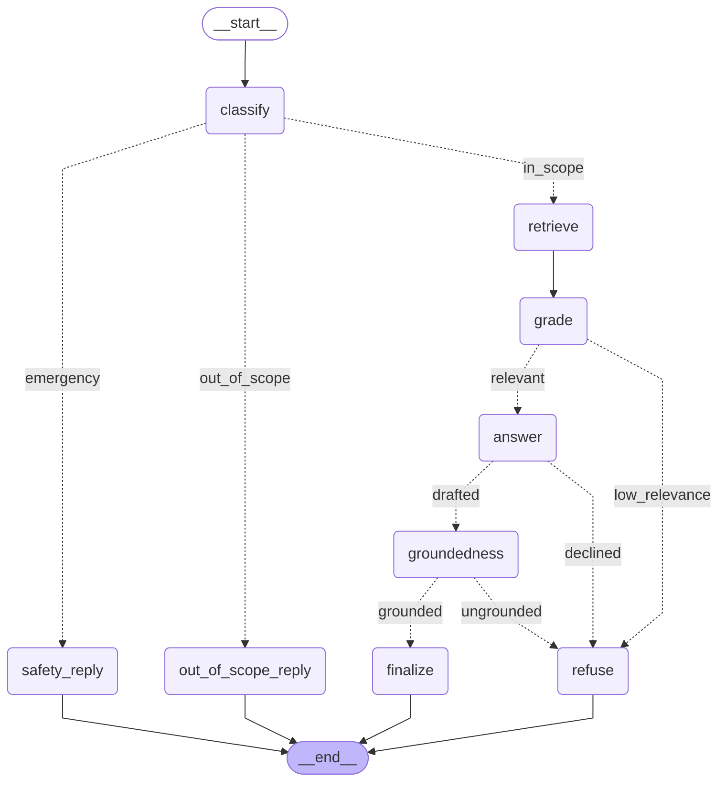

Answers from your documents only, with citations: 100% recall@5, 0 wrong policy answers across 60 test questions, and it says "I don't know" when it should.

# Grounded RAG Agent

An agent that answers only from a company's own documents, with citations, and refuses when the answer is not in them. It ships with an eval suite that proves it, and the eval fails CI if one wrong policy answer gets through.

The example is a fictional clinic group, Harbourside Outpatient Clinics. **The corpus is synthetic.** All 26 documents, names, fees and phone numbers are invented. The question that matters for a real clinic group is the one the eval is built around: can the agent answer patient messages with zero wrong policy answers?

**One honest caveat, up front.** The sentences of answer text in the committed eval run were written offline by Claude from each question's retrieved passages, because no live API key was available when we built it. They were not captured from the Anthropic API. Retrieval, grading, conflict handling, the emergency route and the groundedness check are real code running on every question, and the recorded answers are replayed through all of it. Run `npm run record` with your own key to score a live model. Details are in [eval/report.md](eval/report.md).

## How It Works



1. **classify** is plain code, no model. Emergency phrases ("chest pain") go straight to a fixed safety reply. Medical advice and unrelated requests get a fixed "we only answer clinic questions" reply.
2. **retrieve** runs BM25 and vector search, fuses them with reciprocal rank fusion, then reranks with a simple lexical reranker.
3. **grade** removes outdated documents (the newest document on a topic wins), then checks the retrieved chunks actually cover the question.
4. **answer** asks Claude to answer in one to three sentences, each citing a numbered passage, or to reply `NOT_IN_DOCUMENTS`.
5. **groundedness** checks every sentence: it must cite a real passage, every number in it must appear in that passage, and most of its words must too. Sentences that fail are stripped. If most of the answer fails, the agent refuses.

## The Eval

60 questions in [eval/questions.jsonl](eval/questions.jsonl): 40 answerable (with the gold document and section), 12 unanswerable (must refuse), 5 where three versions of the cancellation policy disagree (must use the newest), and 3 emergencies.

| Metric | Result | Bar |
| --- | --- | --- |
| Retrieval recall@5 | 100.0% | at least 90% |
| Retrieval recall@1 | 82.2% | reported |
| Answer correctness | 100.0% | reported |
| Refusal accuracy | 100.0% | reported |
| Citation precision | 100.0% | reported |
| Conflicts resolved to newest document | 100.0% | reported |
| Emergencies routed to the fixed reply | 100.0% | 100% |
| Wrong policy answers | 0 | 0 |

- **Retrieval recall@5**: the gold section is in the top 5 results.
- **Answer correctness**: the answer contains every key fact and none of the outdated ones (a deterministic match, no model grader).
- **Refusal accuracy**: it answered when it should, and refused when it should.
- **Citation precision**: the cited chunks come from the gold document.
- **Wrong policy answers**: it answered, and the answer was wrong, or it answered a question it should have refused. This must be 0.

`npm run eval` prints this table, writes [eval/report.md](eval/report.md), and exits with an error if wrong answers are above 0, recall@5 is under 90%, an emergency is missed, or a recording has gone stale.

Read the numbers fairly. The corpus is small and the questions were written by the same people who wrote the documents. The retrieval thresholds and the small domain lexicon in `src/lexicon.ts` were set while looking at this question set, so recall@5 will be lower on documents the agent has not seen. Recall@1 (82.2%) is the more demanding retrieval number. The part we trust most is the guard rails, which the unit tests attack directly with deliberately bad model output: an invented number, a missing citation, a citation to a passage that was never provided.

## Why It Refuses

A wrong answer about a fee or a cancellation window costs more than "I don't know". There are four places the agent can decline, listed from cheapest to most expensive:

- **Out of scope**: advice and unrelated questions never reach retrieval or the model.
- **Low relevance**: if the retrieved chunks do not contain most of the question's terms, we refuse before spending a model call.
- **Model declined**: the model is told to reply `NOT_IN_DOCUMENTS` when the passages do not hold the answer.
- **Ungrounded**: a drafted answer that cites nothing, cites a passage it was not given, or contains a number that is not in the cited passage is stripped or refused.

Outdated documents are handled in code rather than left to the model. Documents carry an `effective` date and a `topic`. Three documents share the topic `cancellation-policy`, and the grade step drops any chunk from a document that is not the newest on its topic, swapping in the matching section of the newest one. The model never sees the old numbers.

Emergency messages never touch the model. The classifier is deliberately broad: a false alarm costs one extra sentence.

## Swap in Your Stack

Everything clinic specific is in `corpus/`, `src/config.ts` (reply messages and thresholds) and `src/lexicon.ts`. The rest is interfaces:

- **Embedder**: implement `Embedder` (`embed(texts) => number[][]`). `LocalEmbedder` is deterministic hashed TF-IDF with no key. `VoyageOrOpenAIEmbedder` is optional and reads `VOYAGE_API_KEY` or `OPENAI_API_KEY`. Any other embedder is one small class.
- **Vector store**: implement `VectorStore` (`upsert`, `query`). `InMemoryVectorStore` is the default. [src/adapters/vectorize.ts](src/adapters/vectorize.ts) is an optional Cloudflare Vectorize adapter: create the index with the same dimension as your embedder (1024 for `LocalEmbedder`) and the cosine metric, then pass `env.VECTORIZE`. It is not needed to run anything here. pgvector and Pinecone follow the same two methods.
- **Model**: implement `LLM` (`complete({system, user}) => string`). `AnthropicLLM` calls the Messages API with plain `fetch`, header `anthropic-version: 2023-06-01`, and reads `ANTHROPIC_API_KEY` and `ANTHROPIC_MODEL` (default `claude-haiku-5-5`).
- **Your documents**: markdown files with `title`, `effective` and optional `topic` front matter, split on `##` headings.

Library and API details are current as of November 2026: `@langchain/langgraph` 1.7.5, `@langchain/core` 1.5.1, Node 22, and the Anthropic Messages API at `anthropic-version: 2023-06-01`. This repo does not use MCP.

## Quick Start

No key needed.

```bash
git clone https://github.com/dwadlane/grounded-rag-agent
cd grounded-rag-agent
npm install
npm test          # unit tests
npm run eval      # the 60 question eval, writes eval/report.md
npm run ask "How much is a standard doctor visit?"
```

Without `ANTHROPIC_API_KEY`, `npm run ask` replays the committed recordings, so it only has answers for the eval questions. Six sample runs are in [examples/demo-output.md](examples/demo-output.md): three answered with citations, one refusal, one conflict resolved to the newest document, and one emergency.

To use a live model:

```bash
export ANTHROPIC_API_KEY=...
npm run ask "Can I park for free at Central?" -- --trace
npm run record    # re-record every eval answer from the live model
npm run eval      # now scores the model, not the offline recordings
```

## When It Stops

- If the question is not in the documents, it says so and gives the clinic's phone number. It does not guess.
- If a recording is missing or a model call fails, the agent refuses instead of crashing, and the eval fails so you know the recordings are stale. Any change to the corpus, retriever or prompt changes the prompt hash and needs a re-record (`npm run record`, or `npm run build:recordings` for the offline set).
- The groundedness check is lexical. It catches invented numbers, missing citations and unsupported claims, but it cannot judge a fluent sentence that is true to the words and wrong in meaning. Keep a human review step for anything high stakes.
- Emergency detection is a keyword safety net, not triage.
- The default embedder is lexical. For paraphrase heavy questions, plug in a hosted embedder and re-run the eval.

## Related

- [agent-action-gate](https://github.com/dwadlane/agent-action-gate): let AI agents do real work, with every write proposed, approved, run once and logged.
- [messy-docs-to-records](https://github.com/dwadlane/messy-docs-to-records): messy faxes and invoices in, draft records out, with a 95% accuracy gate in CI.

MIT licensed. See [SECURITY.md](SECURITY.md) to report a problem.

Built by Gaps2Gains. [Book a Free Discovery Call](https://gaps2gains.com/diagnosis)
